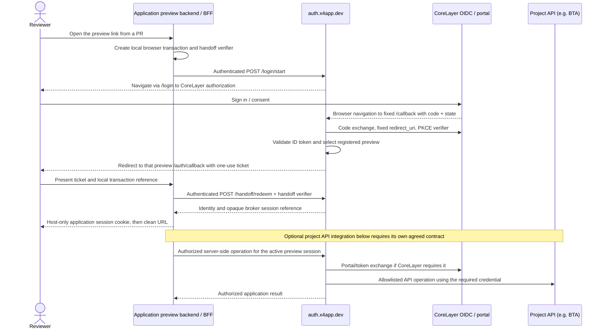

# X4–CoreLayer Preview Authentication Integration Specification

[Open the illustrated HTML edition](corelayer-preview-auth-integration-v1.html) for diagrams and section navigation. The full contract is preserved in both editions.

| Document | Value |
| --- | --- |
| ID | X4-CORELAYER-AUTH-001 |
| Version | 1.3 |
| Date | 2026-10-28 |
| Status | Integration contract for joint review; real-provider acceptance pending |
| Owners | X4: gateway, preview routing and lifecycle. CoreLayer: identity client and downstream authorization contract. Each application team: application session and any API integration. |
| Scope | Project-agnostic authentication for non-production X4 previews using CoreLayer. K12 Prevent is an illustrative consumer. |

This X4 proposal replaces earlier design discussion. It is not CoreLayer approval or production acceptance. **MUST**, **SHOULD**, and **MAY** describe requirements; section 9 shows implementation status. CoreLayer must supply its unknown configuration values.

## Project-agnostic scope

X4 preview routing supports two login contracts: keep the application's direct OIDC integration, or adopt the shared broker and session handoff. Either can serve any project.

| Concern | Direct application OIDC | X4 broker/session handoff |
| --- | --- | --- |
| OAuth client and callback owner | Application's existing client; exact callbacks on its preview origin | Dedicated confidential broker client; fixed `auth.x4app.dev` callbacks |
| Application integration | Existing OIDC/PKCE and API-token flow | Receiving backend/BFF adapter and application-session mapping |
| Stable preview addresses | Generated preview domains or explicit worker HTTPS ports; exact callbacks registered for each selected origin | Per-workspace HTTPS domains support separate cookie hostnames and concurrent previews |
| Portal/BTA access | Existing application exchange and permitted bearer-token contract | Additional server-side API adapter and CoreLayer authorization agreement required |

Sections 4–6 define the broker protocol. Direct OIDC needs no broker registration or receiving adapter. Both contracts require application access control and real-provider testing. Broker adopters need a backend session layer or another explicitly designed receiving adapter.

K12, portal exchange and BTA are optional examples. Identity-only applications need no API adapter. Each application needs its own compatibility and permission checks. One broker deployment supports one upstream client/policy; projects cannot assume shared scopes, tenant access or API permissions.

## 1. Decision and request to CoreLayer

The optional broker at `https://auth.x4app.dev` owns one confidential OIDC client and exchanges authorization codes server-side. Previews receive a session handoff instead of becoming separate CoreLayer clients.

CoreLayer is asked to provision this non-production client with two exact, fixed registrations:

| Client setting | Required value |
| --- | --- |
| `redirect_uris` | `["https://auth.x4app.dev/callback"]` |
| `post_logout_redirect_uris` | `["https://auth.x4app.dev/logout-callback"]` |
| `response_types` | `["code"]` |
| `grant_types` | `["authorization_code"]` for the initial integration |
| `token_endpoint_auth_method` | `client_secret_basic`, supported by the current X4 adapter |
| PKCE | Support `S256`; X4 sends a new verifier/challenge for every authorization request |
| Authorization response mode | Query response to `GET /callback`; the current gateway has no `form_post` callback handler |
| Scope | `openid` required; `profile email` requested by the current example, subject to CoreLayer policy |
| Audience and API permissions | For each application requiring API access, CoreLayer to specify the supported request parameter, audience values, scopes and client policy; portal/BTA is one example |

The [client registration example](corelayer-preview-client.example.json) contains no secret or guessed issuer/audience. CoreLayer should supply the client ID and deliver its secret privately. Keep production clients closed to arbitrary previews.

The broker needs neither wildcard redirects nor per-preview callbacks. Response parameters such as `/callback?code=…&state=…` do not change the registered callback. X4 MUST NOT add a preview-dependent `return_to` query to `redirect_uri`.

Client registration covers broker login only. Portal exchange and BTA compatibility require the separate agreement in section 7.

### Direct application OIDC

Applications may keep their existing CoreLayer client, browser PKCE and permitted API/token-exchange flow. Configure external frontend/API origins before building or starting browser bundles.

CoreLayer MUST register exact application login/logout callbacks and permit its required browser endpoints, origins and CORS. Existing API issuer, audience, scope/tenant and authorized-client restrictions still apply. Agree any `offline_access`, refresh and logout behavior with CoreLayer. Publishing a route grants no permissions.

Direct login uses application callbacks, not `auth.x4app.dev`. Broker codes, identities or sessions cannot simply be passed into the application's OIDC library. Test each application with the real provider.

### Generic direct-login example

A fictional `demo` app has frontend and API templates `frontend-demo-{sandbox}.{domain}` and `api-demo-{sandbox}.{domain}`. Its configured domain is `preview.x4app.dev`.

These are example patterns, not live endpoints. Replace `<sandbox>` with the workspace's 24-character digest and use X4's returned origins. Configure worker domain publishing and Control ingress using the [routing guide](../sandbox-custom-domains.md).

| Setting | Example URL pattern |
| --- | --- |
| Frontend origin | `https://frontend-demo-<sandbox>.preview.x4app.dev` |
| API origin | `https://api-demo-<sandbox>.preview.x4app.dev` |
| Login callback | `https://frontend-demo-<sandbox>.preview.x4app.dev/callback` |
| Post-logout callback | `https://frontend-demo-<sandbox>.preview.x4app.dev/logout-callback` |

Use the application's actual callback paths; `/callback` and `/logout-callback` are examples. CoreLayer must register each preview's exact expanded URLs, never literal placeholders or wildcard callbacks. Wildcard DNS/TLS does not authorize OAuth redirects. The API must enforce its authorization policy and allow the frontend origin where browser CORS is needed.

The operator installs private configuration, starts services and checks health. The application owner and CoreLayer team test real login, API authorization, expiry and logout. HTTPS and synthetic routing checks do not prove authentication.

Each new workspace needs its own direct callback registrations. Fixed worker ports can preserve existing callback URLs (section 3). Broker adopters instead use fixed broker callbacks and a receiving adapter.

### Application-specific setup: K12 Prevent

The [K12 registry](../../registry/k12-prevent.registry.yaml) keeps its `eduforge-shell` OIDC/PKCE and portal/BTA-token flow. Fixed frontend/API ports preserve its URLs; BTA issuer, audience, scope/tenant and `SHELL_ALLOWED_AZP` checks still apply. The [K12 setup guide](../k12-prevent-setup.md) covers exact URLs, private configuration, ownership, startup and testing. Real K12/CoreLayer/BTA sign-in remains unverified. Broker adoption is optional.

## 2. Architecture and ownership

This architecture applies to broker adopters. Direct OIDC keeps the application's existing client, sessions, token handling and authorization.



The final API operations are a target, **not implemented** by the proof of concept. Section 7 defines the agreement needed first. Handoff is an X4 application protocol, not OIDC or a CoreLayer endpoint.

Each gateway deployment has one issuer, client, scope list and optional audience. Registries cannot select clients or broaden permissions. Different policies require explicit trusted client/policy separation before sharing a deployment.

| Owner | Responsibilities |
| --- | --- |
| CoreLayer | Dedicated preview client; issuer/discovery/JWKS; authentication and consent; claims and subject policy; permitted audiences/scopes; portal exchange/BTA credential rules; upstream logout and revocation policy; test identities. |
| X4 | Fixed HTTPS gateway; OIDC client secret custody; transaction binding and token validation; preview registration and revocation; handoff/session service; domain routing; operational controls and future server-side API adapter. |
| Each application team adopting the broker | Integrate the backend session adapter; map identity into its authorization model; enforce CSRF on mutations; preserve permitted local return paths; call its agreed server-side API adapter if needed; handle session expiry and sign-out. |
| Joint acceptance | Test a consuming application and CoreLayer together, including concurrent previews, expiry, logout and replacement; test successful and denied downstream API calls where that application requires them. |

### Terms that must remain distinct

| Term | Meaning |
| --- | --- |
| Workspace | One X4 checkout and its lifecycle state. X4 currently tracks one active sandbox/profile per workspace. |
| Sandbox digest | Stable 24-hex-character digest of the workspace ID, used in DNS names. It is a namespace, not a credential. Reused workspace identities can reuse DNS names. |
| Route publication generation | UUID identifying one ingress publication revision; protects route replacement and stale cleanup. |
| Auth preview ID and generation | Separate broker registration identity and unpredictable lifetime generation. Replacement must invalidate the old auth generation, even when its hostname is reused. |
| OAuth `state` | Unpredictable, single-use reference to a gateway-owned authorization transaction. It is not a preview URL. |
| Local return state | Preview-owned opaque browser transaction reference, distinct from OAuth `state`. |
| Handoff ticket | Short-lived, single-use X4 credential redeemable by the intended preview backend with its handoff verifier and preview credential. It is not a CoreLayer authorization code or access token. |
| Broker session | Gateway-owned session bound to one auth preview generation and identity. The browser receives a separate application session cookie. |

## 3. Preview URLs and concurrent sandboxes

The service registry can declare:

```yaml
preview:
  mode: origin
  hostname: "{service}-{profile}-{sandbox}.{domain}"
```

The worker supplies `{domain}`, currently `preview.x4app.dev`. Each workspace has its own sandbox digest and service origins. `{{preview.backend.origin}}` resolves within that workspace; another preview uses the same registry with a different digest.

Ingress routes each registered hostname to its worker service. DNS/TLS grants no authentication or authorization. The broker selects the originating preview from its trusted transaction and active registration after CoreLayer returns to `auth.x4app.dev`.

Register only browser-facing applications with a receiving auth adapter. Custom hostnames provide no access control: each exposed application MUST enforce its own. The registry has no implemented `auth` field or automatic auth-registration hooks.

### Fixed worker ports and mixed profiles

On a domain-configured worker, an explicit `preview: { mode: origin, port: 13100 }` selects `https://<worker>.ts.net:13100`. It bypasses central domain registration and fails if occupied. Do not combine `preview.hostname` and `preview.port`. Mixed profiles can use pinned and generated origins together.

K12's fixed frontend/API ports preserve its bundle URLs and allow one stack per worker. Change ports, bundle URLs and CoreLayer registrations together. Ports do not isolate cookies. The broker rejects registrations sharing a hostname: use distinct generated domains for concurrent broker previews and review direct-mode cookie/token behavior.

`{{preview.<service>.origin}}` follows the selected address, including a resolvable pinned worker origin. Unpinned browser services use generated domains by default.

Gateway, preview ingress and pinned worker ports require authorized Tailscale access despite public DNS names. Access outside the tailnet needs a separate deployment decision.

## 4. OIDC and browser flow requirements

These broker requirements do not apply to direct OIDC, which follows section 1 and never calls handoff endpoints.

1. At its preview URL, the app creates a random local transaction, browser-binding cookie and separate handoff verifier. A permitted deep link SHOULD be stored locally as a validated same-origin relative path. The example returns to `/`; deep-link support needs application work.
2. Its backend authenticates to `POST /login/start` with its preview ID/generation, opaque local return state and SHA-256 handoff challenge. The global registration credential MUST NOT be available to the preview.
3. The browser opens the returned opaque login URL. The gateway creates independent OAuth `state`, nonce, PKCE verifier and browser binding. Separate tabs/previews MUST have separate records and cookies.
4. The gateway requests `response_type=code` with the fixed `redirect_uri`, agreed scopes, PKCE `S256`, state and nonce. Audience parameters MUST follow CoreLayer's contract.
5. At the fixed `/callback`, the gateway checks browser binding, state, expiry and preview generation. It exchanges the code using the same client, fixed `redirect_uri` and original verifier.
6. The gateway MUST validate ID-token signature, issuer, client audience, expiry and nonce against trusted discovery/JWKS. These gateway-client tokens MUST NOT be treated as tokens issued to an application's former client. Checks must still hold after asynchronous provider work, including transaction/lease expiry.
7. The gateway redirects to the registered origin's `/auth/callback` with an opaque ticket and local transaction reference. It MUST NOT accept browser-supplied external destinations. Ticket expiry, generation and browser/verifier binding MUST be checked before session creation.
8. The preview checks its browser transaction and redeems the ticket server-side with its limited credential and handoff verifier. Redemption MUST atomically consume the ticket. The browser redirect carries no CoreLayer access/refresh token or client secret.
9. The preview rotates its session ID, sets its cookie and redirects to a clean URL. It MUST NOT leave the ticket in a shareable URL. Replayed, cross-preview, expired or stale-generation callbacks MUST fail closed.

### Cookies, CSRF and token handling

- Gateway/preview session and binding cookies MUST be host-only, `HttpOnly`, `Secure`, `Path=/`, with an HTTPS `__Host-` name. Shared `Domain=.x4app.dev` session cookies are prohibited. Ports do not isolate cookies.
- Sibling previews under `x4app.dev` can be **same-site** despite different origins. `SameSite=Lax` does not protect against hostile siblings. Mutations MUST use exact-origin CSRF checks and/or bound CSRF tokens. Production APIs MUST NOT implicitly trust non-production origins.
- Callback/handoff responses MUST set `Cache-Control: no-store` and a referrer policy preventing parameter leaks. Logs/traces/metrics MUST exclude callback queries, tickets, codes, session credentials and tokens.
- Upstream tokens stay with the broker. Handoff returns only `{iss, sub, name?, email?}` and an opaque session reference, without tenant/role claims, access tokens or BTA permission proof.
- The adapter does not call UserInfo; `profile`/`email` scopes do not guarantee ID-token claims. CoreLayer and the app team MUST agree delivery and verified mapping of required identity/authorization claims. Extending the identity whitelist needs application work.
- Authorization MUST use validated subject/tenant/permission data, never display names or unverified email. Identity is `(iss, sub)`; CoreLayer must confirm continuity or mapping for pairwise subjects.

## 5. Existing X4 broker interface

These X4-owned proof-of-concept routes select and authenticate previews; CoreLayer need not implement them. In OIDC mode, JSON bodies are limited to 16 KiB and `expiresAt` is Unix epoch milliseconds.

| Method and path | Authentication / request | Success |
| --- | --- | --- |
| `GET /health` | Liveness only | `200`, mode/configuration metadata |
| `GET /readyz` | Discovery check | `200` if required metadata exists; otherwise `503` |
| `POST /previews` | Controller bearer; `{id, generation, origin, redeemSecret, leaseMs?}` | `201`, `{id, generation, origin, expiresAt}`; same generation and origin/credential renews |
| `DELETE /previews/:id` | Controller bearer; `{generation}` | `200`, `{removed: true}` |
| `POST /login/start` | Preview bearer; `{previewId, generation, returnState, challenge}` | `200`, `{loginUrl}` |
| `GET /login?request=…` | Browser; one-use request handle | `303` to CoreLayer |
| `GET /callback` | Browser; CoreLayer authorization response and bound cookie/state | `303` to registered preview handoff callback |
| `POST /handoff/redeem` | Preview bearer; `{previewId, generation, ticket, verifier}` | `200`, `{identity, sessionId, expiresAt}` |
| `POST /session/validate` | Preview bearer; `{previewId, generation, sessionId}` | `200`, `{active: false}` or `{active: true, identity, expiresAt}` |
| `POST /session/logout` | Preview bearer; `{previewId, generation, sessionId}` | `200`, `{logoutUrl}` after removing the initiating broker session |
| `GET /logout?request=…` | Browser; one-use request handle | `303` to provider RP-initiated logout |
| `GET /logout-callback` | Browser; correlated logout state/cookie | `303` to initiating preview origin |

The globally trusted controller bearer can register HTTPS origins and replace registrations. Each preview's separate `redeemSecret` works only for its registered generation. Before automating lifecycle, X4 MUST restrict registration to active owned ingress routes and coordinate concurrent replacement, rotation and stale cleanup. Ingress and auth registration remain separate operations.

Registration IDs accept 1–64 letters, digits, `_` or `-`; auth generations and return state accept 20–128 base64url characters. IDs may be readable. The example generates 32 random bytes for generations, credentials and opaque transaction references. Production credentials MUST have at least 256 bits of cryptographic randomness; parser limits are not a generator policy.

| Limit / timeout | Current default |
| --- | --- |
| Active auth previews | 100 |
| Entries per transaction/session store | 1,000 |
| Preview lease | 1 hour; accepted range 1 second–1 hour; renewal required |
| Login start / OAuth transaction | 5 minutes each |
| Handoff ticket | 30 seconds |
| Broker session | At most 15 minutes and capped by reported access-token lifetime |
| Logout start / transaction | 60 seconds each |
| OIDC network timeout | 5 seconds |
| HTTP request/header timeout | 10 seconds |

Without `expires_in`, the adapter assumes five minutes; this does not prove CoreLayer token validity. CoreLayer and X4 MUST agree authoritative expiry before real acceptance. Session validation checks only local session/generation/lease expiry, not upstream introspection, revocation or BTA permissions.

Errors: `400` invalid flow/callback exchange; `401` invalid bearer; `409` registration conflict; `410` missing/expired/replaced preview; `413` oversized body; `503` discovery/readiness/capacity failure. Unexpected failures, including unsupported/missing logout metadata, return generic `500`; readiness does not check logout. Registration validity precedes bearer checking, so a missing registration may return `410` first. Preview adapters return generic `503` for required gateway failures. Errors MUST NOT expose provider responses or credentials. Setup mode returns `503` for readiness and all auth/registration/session operations; health returns `200` with `configured: false`.

## 6. Lifecycles, expiry, refresh and logout

**Required lifecycle:** allocate URLs, start and verify the app, register only its active receiving origin with a fresh auth generation and limited secret, and renew its lease. Mark it auth-ready only after integration checks. On stop, replacement or reap, invalidate its generation, sessions and tickets; retire routes/listeners; clean up the app. Failures MUST leave a recoverable record and MUST NOT advertise a stopped or unauthenticated app as ready. Cross-system ordering/retries remain unimplemented; there is no distributed atomicity.

Reusing DNS does not reuse auth generation. Recreating an app at the same hostname MUST NOT admit old tickets or sessions. Routing has separate generation checks and recovery journals; CLI auth registration, renewal and removal remain unimplemented.

**Expiry/refresh:** the broker has no refresh flow. Expiry requires login again; CoreLayer may reuse its SSO session. The initial client request excludes `offline_access` and `refresh_token`. Adding them requires agreement on consent, encrypted token storage, rotation/reuse detection, revocation and concurrent refresh. Refresh tokens MUST stay server-side with their owning OAuth client.

**Current logout:** the sample removes the initiating app/broker sessions, then requests upstream RP-initiated logout with `id_token_hint`, the fixed post-logout URI and fresh bound state. Other preview sessions remain locally active until expiry or invalidation. Mock tests prove only this local behavior, not CoreLayer SSO/global logout. Provider logout may affect later sign-in elsewhere.

**Before activation:** CoreLayer, X4 and application teams must choose local versus upstream SSO sign-out, and whether global logout/revocation must immediately invalidate all related sessions. Local-only logout needs a separate action; immediate global invalidation needs provider notifications or another agreed mechanism. Neither exists in the current route. There MUST be no UI or security claim of global logout until propagation is implemented and accepted.

## 7. Project-specific API adapters: portal/BTA example

This optional adapter applies only to applications needing downstream APIs. K12 portal exchange/BTA is the example; other projects supply their own API contracts. Identity-only apps need no adapter. API requirements are separate from shared handoff.

The broker proof authenticates identity but makes no portal/BTA request. A gateway-audience ID token MUST NOT be a BTA bearer unless BTA explicitly requires that token type. Broker sessions grant no API permissions.

The target keeps portal exchange and allowlisted BTA calls server-side under the broker, acting for the app backend's authenticated session. This avoids browser exchange CORS and exposes no upstream credentials to preview code. It needs an API adapter, authorization rules and scoped operations, all absent today. It MUST NOT become a general HTTP proxy or trust browser-supplied upstream URLs.

CoreLayer must supply the following before the API adapter contract can be finalized:

| Required fact | Question to resolve |
| --- | --- |
| Portal exchange | What endpoint/protocol, caller authentication, grant/input token type, audience/resource parameters and output token are required? Is the dedicated preview client permitted? |
| BTA authorization | Which API/environment and operation should acceptance test? Which token issuer, audience, scopes/roles, tenant/user claims and client restrictions does it enforce? |
| User mapping | Is `(iss, sub)` stable for the new client? If not, which approved mapping preserves the application's existing user/tenant without trusting email alone? |
| Lifetime/revocation | What are access/portal token expiry, refresh, rotation, revocation and logout guarantees? How quickly must permission changes take effect? |
| Trust and placement | May the central broker perform the portal exchange and BTA calls? Do any existing rules require the application's existing client, backend identity, browser session or browser-held token? |
| CORS | Can all token exchange/API operations be server-side? If the application must call an API from the browser, what exact origin policy is supported for preview origins? |

Browser-held tokens or another confidential client require a reviewed design; never silently relay broker codes/tokens into an OIDC library. Broker callbacks stay fixed, but app/API integration may change. Direct OIDC keeps the existing exchange/API flow outside the broker. CoreLayer must supply actual portal/BTA endpoints, claims and scopes.

## 8. Connectivity and operating requirements

This table covers the broker. Direct OIDC needs browser access to its selected HTTPS origins and CoreLayer discovery/token/portal endpoints, with browser origins/CORS approved by provider/API owners.

| Connection | Required access |
| --- | --- |
| Reviewer browser → preview and `auth.x4app.dev` | HTTPS 443 with current Tailscale access; exact Host/SNI routing |
| Reviewer browser → CoreLayer | Authorization, login/consent and supported logout pages |
| Preview backend → gateway | Authenticated HTTPS server-to-server operations; no browser CORS needed for these calls |
| Gateway → CoreLayer | HTTPS discovery, authorization metadata, token and JWKS; portal/API endpoints only once agreed |
| Gateway → BTA | Required only for the selected future server-side API adapter |

The gateway runs continuously on `control01.x4app.dev` behind private ingress. Its listener stays on loopback; ingress preserves the external Host. Tailscale access does not replace identity or application authorization.

Before shared real-user use, X4 MUST provide reviewed secret storage/rotation, protected transaction/session state, bounded retention/capacity, readiness/failure monitoring, redacted audits, backup/recovery and tested restarts. The single-process in-memory broker loses registrations/sessions on restart and cannot share state across replicas. X4 must implement durable/shared state or explicitly accept and document single-instance reauthentication for a limited pilot. `/readyz` checks discovery metadata only, not secrets, login/logout, API permissions or registrations.

Ingress state persists separately, without an independent abandoned-worker lease/reconciler. Auth expiry does not remove routes. Applications MUST reject unauthenticated requests even when routes outlive registration. Route retirement/reconciliation and auth lifecycle need completion before claiming automatic end-to-end cleanup.

## 9. Implementation status and integration requirements

| Capability | Implementation | Integration requirement / evidence boundary |
| --- | --- | --- |
| Registry `preview.hostname`, scoped origin references | Implemented | Install a compatible CLI on every worker using these registry fields |
| Dynamic private HTTPS preview routing | Implemented | Configure worker domain publishing and Control ingress; routing checks do not verify application sign-in |
| Explicit `preview.port` on domain-configured workers; mixed pinned/generated routing | Implemented | Use one fixed-port stack per worker; verify mixed routing and occupied-port rejection |
| Direct application OIDC with the K12 Prevent registry | Existing application flow retained by the registry | Requires the private testing bundle and exact CoreLayer registrations; real K12/CoreLayer sign-in, browser exchange/CORS and BTA permissions remain unverified |
| Single-callback OIDC broker + preview session handoff | Standalone proof of concept, mock provider tested | `auth.x4app.dev` installed in **setup mode**, real login disabled |
| Cookie/browser binding, PKCE, nonce and signature checks | Proof of concept with automated tests | Mock evidence; real CoreLayer acceptance pending |
| Real application receiving adapters and authorization mapping | Sample adapter only; no real project broker integration verified here | Required for broker adopters; direct applications retain their own authentication integration |
| Automatic auth registration, renewal, removal in X4 | Not implemented | Required lifecycle work; domain publishing alone does not provide it |
| Broker portal exchange and BTA API authentication | Not implemented/verified | CoreLayer contract and API adapter required; direct mode retains the existing app flow, unverified here |
| Refresh, immediate global logout/revocation propagation | Not implemented | Policy and implementation required if in scope |
| Durable/shared auth state, production operations | Not implemented | Pilot operating policy or additional implementation required |

Use the [domain runbook](../sandbox-custom-domains.md) for routing and [gateway runbook](../../examples/preview-auth-gateway/deploy/README.md) for the optional broker. Record tested/deployed versions; local tests do not verify running services.

The [K12 setup guide](../k12-prevent-setup.md) covers setup and application testing. Routing/mock-provider tests do not establish real CoreLayer compatibility.

## 10. Acceptance and rollout gates

These gates cover broker rollout. Direct K12 testing must prove its app callbacks, PKCE/exchange/CORS, BTA authorization, expiry/logout and fixed-port conflict/cleanup behavior. Routing compatibility alone proves none of these; fixed ports support neither concurrent copies on one worker nor a shared broker callback.

| Gate | Acceptance evidence | Owners |
| --- | --- | --- |
| A. Contract agreed | Dedicated client; exact callbacks; issuer, client authentication, scopes, identity mapping and logout policy agreed; application-specific audience/API requirements recorded if applicable; secret delivered securely | CoreLayer + X4 + application team |
| B. Real-provider pilot | Two previews of a real consuming application complete CoreLayer login through the same callback and establish correctly mapped application sessions; denied consent/invalid client fails closed | X4 + application team + CoreLayer |
| C. API authorization, if required | Each preview performs its agreed downstream API operation for its own user/tenant; wrong audience, insufficient permission and cross-tenant attempts are denied. Record not applicable for an identity-only application. | Application team + API owner + CoreLayer + X4 |
| D. Isolation and lifecycle | Parallel users/tabs/previews, replay/wrong-state/wrong-verifier rejection, exact-origin CSRF, lease expiry, auth generation replacement, stop/reap/retry and hostname reuse verified | X4 + application team |
| E. Session operations | Real expiry/reauthentication, agreed refresh if enabled, explicit local/upstream/global logout policy, upstream outage and restart/recovery tested | Joint |
| F. Shared-use release | Operational controls and rollback reviewed; source/deployed versions recorded; no mock provider enabled; existing static routes preserved | X4 operations |

Gate D tests MUST reject cross-preview tickets and transactions whose lease/generation expired, and prove stopping/replacing A leaves B reachable under its own session policy. One preview's session MUST NOT create a shared parent-domain cookie or grant authorization in another.

Mock/routing tests cannot satisfy Gates B, C or CoreLayer-specific parts of E. Initial activation SHOULD be a controlled non-production pilot. Rollback disables auth initiation/readiness and invalidates broker sessions, preserving unrelated routes. Any route left reachable must still enforce application authentication.

## 11. CoreLayer response worksheet

CoreLayer should return non-secret settings in this table and deliver credentials through the approved secret mechanism.

| Input | CoreLayer response |
| --- | --- |
| Selected contract: direct application OIDC or broker handoff | Confirm per consuming application |
| Direct applications: client ID, exact app-origin login/logout callbacks and browser endpoint/CORS policy | Confirm for existing application contract |
| Environment / tenant and deployed Hydra version | To provide |
| Exact issuer URL and discovery URL | To provide |
| Dedicated client ID; `client_secret_basic` accepted? | To provide |
| Both fixed redirect registrations confirmed | To provide |
| PKCE S256, signing algorithms and JWKS rotation | To provide |
| Approved scopes, audience/resource parameter and values | To provide |
| Required user/tenant/permission claims and subject continuity | To provide |
| Portal exchange documentation and dedicated-client eligibility, where needed by a consuming application | To provide, or record not applicable |
| Required downstream API test environment, token and one allowed/denied operation (e.g. BTA for K12) | To provide per application, or record not applicable |
| Token expiry, refresh/rotation/revocation and logout policy | To provide |
| Whether server-side exchange/API calls satisfy policy; remaining CORS requirements | To provide |
| Test accounts/roles and coordination contact | To provide through appropriate channels |

## References

- [OIDC Core: authentication requests and redirect URI requirements](https://openid.net/specs/openid-connect-core-1_0.html#AuthRequest), [ID-token validation](https://openid.net/specs/openid-connect-core-1_0.html#IDTokenValidation).
- [OAuth 2.0 code exchange, RFC 6749 §4.1.3](https://www.rfc-editor.org/rfc/rfc6749.html#section-4.1.3), [refresh, §6](https://www.rfc-editor.org/rfc/rfc6749.html#section-6).
- [OAuth security BCP, RFC 9700](https://www.rfc-editor.org/rfc/rfc9700.html), [PKCE, RFC 7636](https://www.rfc-editor.org/rfc/rfc7636.html).
- [OIDC RP-Initiated Logout](https://openid.net/specs/openid-connect-rpinitiated-1_0.html).
- [OIDC Discovery](https://openid.net/specs/openid-connect-discovery-1_0.html#ProviderConfig), [subject stability](https://openid.net/specs/openid-connect-core-1_0.html#ClaimStability) and [pairwise subject identifiers](https://openid.net/specs/openid-connect-core-1_0.html#PairwiseAlg).
- [Cookie scope, same-site requests and host-prefixed cookies (IETF working draft)](https://www.ietf.org/archive/id/draft-ietf-httpbis-rfc6265bis-22.html).
- [Ory client configuration and redirect requirements](https://github.com/ory/docs/blob/4a8e1bb690e9538235095595eabd3fa72a82d571/docs/hydra/guides/oauth2-clients.mdx), [Hydra client fields](https://github.com/ory/hydra/blob/4174065ffb052799890f7480f5360a877a67ffc1/client/client.go), [Ory CORS](https://github.com/ory/docs/blob/4a8e1bb690e9538235095595eabd3fa72a82d571/docs/hydra/guides/cors.mdx).
- [Local protocol research and source citations](../ai-research/research-x4-corelayer-preview-auth-gateway.md), [current contract audit](../ai-research/corelayer-integration-contract-audit.md).
- [Gateway implementation](../../examples/preview-auth-gateway/gateway.mjs), [sample receiving adapter](../../examples/preview-auth-gateway/preview.mjs), [registry/domain guide](../sandbox-custom-domains.md).

### Revision history

| Version | Change |
| --- | --- |
| 1.0 | Initial X4 integration contract for CoreLayer review, including fixed client registration, current broker interface, implementation gaps and joint acceptance gates. |
| 1.1 | Clarify project-agnostic scope, per-application adapter ownership and acceptance, with K12/portal/BTA as an optional worked example. |
| 1.2 | Support direct application OIDC alongside optional broker adoption; document authoritative pinned worker ports, mixed routing and the existing application authentication contract. |
| 1.3 | Add a generic direct-login example and the K12 setup guide with application-specific callbacks and configuration ownership; distinguish routing and mock-provider evidence from real-provider acceptance. |
