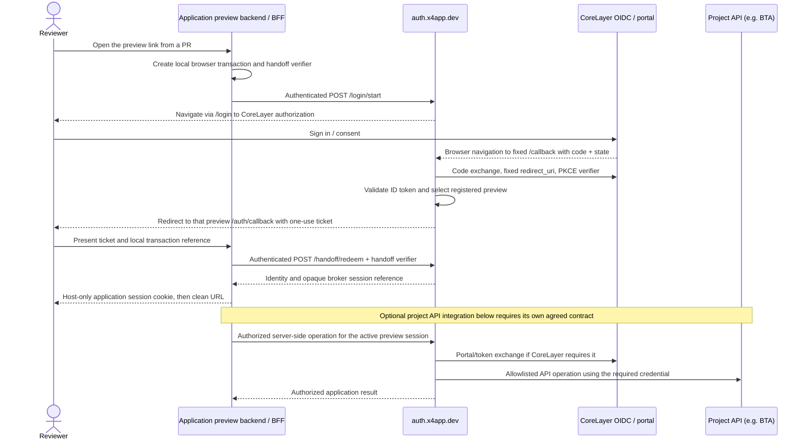

# X4–CoreLayer Preview Authentication Integration Specification

[Open the illustrated HTML edition](corelayer-preview-auth-integration-v1.html) for diagrams and section navigation. The full contract is preserved in both editions.

| Document | Value |
| --- | --- |
| ID | X4-CORELAYER-AUTH-001 |
| Version | 1.2 |
| Date | 2026-10-27 |
| Status | Integration proposal ready for CoreLayer and consuming application teams to review; real-provider acceptance pending |
| Owners | X4: gateway, preview routing and lifecycle. CoreLayer: identity client and downstream authorization contract. Each application team: application session and any API integration. |
| Scope | Project-agnostic authentication for non-production X4 previews using CoreLayer. K12 Prevent is an illustrative consumer. |

This document is the integration contract proposed by X4. It supersedes earlier design discussion for this integration. It does not claim CoreLayer approval or production readiness. **MUST**, **SHOULD**, and **MAY** describe the target integration; the implementation-status table identifies what currently exists. Unknown CoreLayer-specific values are explicit inputs to obtain, not assumptions about its deployed Hydra configuration.

## Project-agnostic scope

X4 provides preview routing independently of application authentication. Applications may keep their existing direct OIDC integration or adopt the fixed-callback broker/session handoff. Neither contract contains K12-specific route selection. SDAC, Handbook, TAP, K12 or a new project can choose the contract that fits its authentication and API requirements.

| Concern | Direct application OIDC | X4 broker/session handoff |
| --- | --- | --- |
| OAuth client and callback owner | Application's existing client; exact callbacks on its preview origin | Dedicated confidential broker client; fixed `auth.x4app.dev` callbacks |
| Application integration | Existing OIDC/PKCE and API-token flow | Receiving backend/BFF adapter and application-session mapping |
| Stable preview addresses | Explicit worker HTTPS ports support existing registered URLs | Per-workspace HTTPS domains support separate cookie hostnames and concurrent previews |
| Portal/BTA access | Existing application exchange and permitted bearer-token contract | Additional server-side API adapter and CoreLayer authorization agreement required |

Sections 1–2 describe the broker architecture alongside the direct option; the broker protocol requirements in sections 4–6 apply to applications adopting that broker. Choosing direct OIDC does not require its receiving adapter or broker registration. Routing, application access control and real-provider acceptance remain necessary for both contracts. A broker adopter without a backend session layer may need a backend/BFF or another explicitly designed receiving adapter.

K12 is an example consumer, not a required dependency or a privileged project. Portal exchange and BTA are example downstream integrations for that consumer; an application needing only identity does not need them. Every application still needs its own compatibility and permission checks. Project-agnostic does not imply that all projects may share the same upstream client, scopes, tenant access or API permissions: the broker deployment currently supports one trusted upstream client/policy, as described in section 2.

## 1. Decision and request to CoreLayer

For applications adopting session handoff, X4 provides a central authentication broker at `https://auth.x4app.dev`. The broker owns one dedicated confidential OIDC client and completes authorization-code exchange server-side. Individual previews receive an application-session handoff after authentication. They do not each become a CoreLayer OAuth client.

CoreLayer is asked to provision this non-production client with two exact, fixed registrations:

| Client setting | Required value |
| --- | --- |
| `redirect_uris` | `["https://auth.x4app.dev/callback"]` |
| `post_logout_redirect_uris` | `["https://auth.x4app.dev/logout-callback"]` |
| `response_types` | `["code"]` |
| `grant_types` | `["authorization_code"]` for the initial integration |
| `token_endpoint_auth_method` | `client_secret_basic`, supported by the current X4 adapter |
| PKCE | Support `S256`; X4 sends a new verifier/challenge for every authorization request |
| Authorization response mode | Query response to `GET /callback`; the current gateway has no `form_post` callback handler |
| Scope | `openid` required; `profile email` requested by the current example, subject to CoreLayer policy |
| Audience and API permissions | For each application requiring API access, CoreLayer to specify the supported request parameter, audience values, scopes and client policy; portal/BTA is one example |

The [machine-readable client registration example](corelayer-preview-client.example.json) contains no secret or guessed issuer/audience. CoreLayer should supply a client ID and deliver its secret through an approved secret channel. No production client should be modified to allow arbitrary previews.

CoreLayer does **not** need a preview-hostname wildcard, a list of preview ports, or a change to OAuth redirect matching for this design. Its ordinary callback contains the protocol response parameters, for example `/callback?code=…&state=…`; these response parameters do not require registering a separate callback for every transaction. X4 MUST NOT add a preview-dependent `return_to` query to the registered `redirect_uri`.

This conclusion covers broker OIDC callback routing. Whether the dedicated client can use CoreLayer's portal exchange and BTA is a separate contract to confirm in section 7. Client provisioning alone does not establish that compatibility.

### Direct application OIDC: K12 Prevent

The [K12 Prevent registry in PR #121](https://github.com/X4Org/x4/pull/121) uses the BTA product (`apps/k12-prevent` and BTA-POC), independently of the Mastra `k12` profile. It retains the application's `eduforge-shell` client, browser PKCE and portal token exchange. Its frontend and BTA API publish at the worker's pinned HTTPS ports `13100` and `15000`; the worker-local bundle supplies their exact URLs before Vite starts.

For this contract, CoreLayer MUST register the exact frontend-origin `/callback` and `/logout-callback` URLs and permit the browser endpoints, origins and CORS behavior required by the existing OIDC/token-exchange flow. The existing BTA issuer, audience, scope/tenant and `SHELL_ALLOWED_AZP` authorization requirements still apply. X4 does not grant those permissions by publishing a route. Any `offline_access`, refresh or logout behavior remains the application's existing contract to confirm with CoreLayer.

Direct sign-in bypasses the broker. Its callbacks do not become `auth.x4app.dev` callbacks, and it does not gain the broker's one-callback property. Passing a broker authorization code, identity or session into the application's current OIDC library does not bridge the contracts. Real K12 Prevent/CoreLayer/BTA sign-in remains unverified by this source compatibility change.

## 2. Architecture and ownership

The following architecture and broker ownership apply when an application adopts session handoff. Direct OIDC retains the application's existing client, session/token handling and authorization responsibilities.



The optional API operations at the end are the preferred target for applications needing downstream API access and are **not implemented** by the proof of concept. Section 7 defines the decision gate before each application's API wire contract can be finalized. The handoff protocol is an X4 application protocol, not an OIDC standard or a new CoreLayer endpoint.

The current standalone gateway has one issuer, client, scope list and optional audience per deployment. A project registry cannot select different upstream clients or broaden permissions. If projects require different CoreLayer policies, X4 must design explicit trusted client/policy separation before supporting them through the same deployment.

| Owner | Responsibilities |
| --- | --- |
| CoreLayer | Dedicated preview client; issuer/discovery/JWKS; authentication and consent; claims and subject policy; permitted audiences/scopes; portal exchange/BTA credential rules; upstream logout and revocation policy; test identities. |
| X4 | Fixed HTTPS gateway; OIDC client secret custody; transaction binding and token validation; preview registration and revocation; handoff/session service; domain routing; operational controls and future server-side API adapter. |
| Each application team adopting the broker | Integrate the backend session adapter; map identity into its authorization model; enforce CSRF on mutations; preserve permitted local return paths; call its agreed server-side API adapter if needed; handle session expiry and sign-out. |
| Joint acceptance | Test a consuming application and CoreLayer together, including concurrent previews, expiry, logout and replacement; test successful and denied downstream API calls where that application requires them. |

### Terms that must remain distinct

| Term | Meaning |
| --- | --- |
| Workspace | One X4 checkout and its lifecycle state. X4 currently tracks one active sandbox/profile per workspace. |
| Sandbox digest | Stable 24-hex-character digest of the workspace ID, used in DNS names. It is a namespace, not a credential. Reused workspace identities can reuse DNS names. |
| Route publication generation | UUID identifying one ingress publication revision; protects route replacement and stale cleanup. |
| Auth preview ID and generation | Separate broker registration identity and unpredictable lifetime generation. Replacement must invalidate the old auth generation, even when its hostname is reused. |
| OAuth `state` | Unpredictable, single-use reference to a gateway-owned authorization transaction. It is not a preview URL. |
| Local return state | Preview-owned opaque browser transaction reference, distinct from OAuth `state`. |
| Handoff ticket | Short-lived, single-use X4 credential redeemable by the intended preview backend with its handoff verifier and preview credential. It is not a CoreLayer authorization code or access token. |
| Broker session | Gateway-owned session bound to one auth preview generation and identity. The browser receives a separate application session cookie. |

## 3. Preview URLs and concurrent sandboxes

The service registry can declare:

```yaml
preview:
  mode: origin
  hostname: "{service}-{profile}-{sandbox}.{domain}"
```

The execution worker supplies `{domain}`, currently `preview.x4app.dev`. Different workspace IDs produce different sandbox digests. A second preview of the same project uses the same registry with a different digest. Backend and other service origins use that same workspace namespace; `{{preview.backend.origin}}` resolves within the current workspace.

X4's ingress routes the exact registered hostname to the correct worker service. Wildcard DNS/TLS supports hostname creation; it does not grant authentication or authorization. For broker adopters, CoreLayer redirects to `auth.x4app.dev`. The gateway subsequently selects the originating preview from its trusted transaction and active registration.

Only browser-facing applications that integrate the receiving auth adapter should be registered with the auth broker. Giving a frontend, backend, Mastra or admin service a custom hostname does not itself protect it. Each exposed application MUST enforce its own required access control. The current registry has no implemented `auth` configuration field or automatic auth-registration hooks.

### Fixed worker ports and mixed profiles

An explicit `preview: { mode: origin, port: 13100 }` is authoritative even on a worker configured for domain publishing. On a domain-configured execution host it selects `https://<worker>.ts.net:13100`, skips central domain registration for that service and fails if the port is already occupied. Do not combine `preview.hostname` and `preview.port` on one service. Unpinned HTTP services retain generated workspace domains, and a mixed profile can contain both kinds of service.

This preserves PR #121's existing env-bundle URLs without changing its registry. Its fixed frontend/API pair permits one such stack per worker unless the ports, bundle URLs and CoreLayer registrations are changed together. Separate ports on the same worker hostname do not isolate cookies. The broker rejects registrations sharing a hostname; use distinct generated domains for concurrent broker previews and review the application's cookie/token behavior in direct mode.

`{{preview.<service>.origin}}` references follow the selected service address, including a pinned worker origin when available. Generated domains remain the default for unpinned browser services; choosing fixed ports is an explicit compatibility choice.

Reviewers currently require authorized Tailscale access to the gateway, preview ingress and pinned worker HTTPS ports. These are private services despite their public DNS names. Supporting reviewers outside the tailnet would be a separate network/access deployment decision.

## 4. OIDC and browser flow requirements

These requirements describe broker adoption. Direct application OIDC follows the application/CoreLayer contract in section 1 and does not call the handoff endpoints.

1. The application begins at its own preview URL. It creates a random local transaction, browser-binding cookie and separate handoff verifier. A permitted deep-link return path SHOULD be stored locally as a validated same-origin relative path. The example returns to `/`; deep-link preservation is application integration work.
2. Its backend authenticates to `POST /login/start`, using its current preview ID/generation, opaque local return state and SHA-256 handoff challenge. The global registration credential MUST NOT be available to the preview.
3. The browser visits the returned opaque gateway login URL. The gateway creates independent OAuth `state`, nonce, PKCE verifier and gateway browser binding for this transaction. Multiple tabs/previews MUST use separate records and cookies.
4. The gateway requests authorization using `response_type=code`, the exact fixed `redirect_uri`, agreed scopes, PKCE `S256`, state and nonce. Audience parameters MUST follow CoreLayer's documented contract.
5. CoreLayer returns the browser to the fixed gateway `/callback`. The gateway verifies the browser binding, state, transaction expiry and current preview generation; it exchanges the code as the same client with the original fixed `redirect_uri` and verifier.
6. The gateway MUST validate the ID-token signature, issuer, client audience, expiry and nonce using the issuer's trusted discovery/JWKS. ID tokens are for the gateway client and MUST NOT be accepted as ID tokens issued to an application's previous client. Validation must still hold if asynchronous provider work finishes after a transaction or preview lease expires.
7. The gateway redirects to the registered origin's fixed `/auth/callback` with an opaque ticket and local transaction reference. It MUST NOT accept a browser-supplied external destination. Ticket expiry, preview generation and browser/verifier binding MUST be checked before establishing a session.
8. The preview validates its own browser transaction, then redeems the ticket server-side with its limited credential and handoff verifier. Redemption MUST atomically consume the ticket. No CoreLayer access token, refresh token or client secret is returned through this browser redirect.
9. The preview rotates its local session identifier, sets its own cookie and redirects to a clean application URL. It MUST NOT continue displaying the ticket in a shareable URL. Replayed, cross-preview, expired or stale-generation callbacks MUST fail closed.

### Cookies, CSRF and token handling

- Gateway and preview session/binding cookies MUST be host-only, `HttpOnly`, `Secure`, and use `Path=/` with an HTTPS `__Host-` name. A shared `Domain=.x4app.dev` session cookie is prohibited. Separate ports alone do not isolate cookies.
- Preview subdomains beneath `x4app.dev` can be **same-site** despite being different origins. `SameSite=Lax` is not protection against a hostile sibling preview. State-changing application requests MUST use exact-origin CSRF checks and/or an appropriately bound CSRF token. Non-production origins MUST NOT be implicitly trusted by production APIs.
- Callback/handoff responses MUST use `Cache-Control: no-store` and a referrer policy that prevents leaking response parameters. Logs/traces/metrics MUST exclude callback query strings, tickets, authorization codes, session credentials and tokens.
- The broker owns upstream token material. The example only hands off `{iss, sub, name?, email?}` and an opaque session reference. It does not hand off tenant/role claims, an access token or proof of BTA permission.
- The current adapter does not call UserInfo. Requested `profile`/`email` scopes do not guarantee those claims will be present in the ID token. CoreLayer and the consuming application team MUST agree the delivery and verified mapping of every required identity/authorization claim; extending the current identity whitelist is additional application work.
- Authorization MUST use validated subject/tenant/permission information, not a display name or unverified email. The identity key is the `(iss, sub)` pair. CoreLayer must confirm subject continuity or an explicit mapping when the dedicated client uses pairwise subjects.

## 5. Existing X4 broker interface

These routes describe the current standalone proof of concept in OIDC mode. They are X4-owned and are included so CoreLayer can understand how previews are selected. CoreLayer is not asked to implement them. JSON bodies are bounded to 16 KiB; `expiresAt` is Unix epoch milliseconds.

| Method and path | Authentication / request | Success |
| --- | --- | --- |
| `GET /health` | Liveness only | `200`, mode/configuration metadata |
| `GET /readyz` | Discovery check | `200` if required metadata exists; otherwise `503` |
| `POST /previews` | Controller bearer; `{id, generation, origin, redeemSecret, leaseMs?}` | `201`, `{id, generation, origin, expiresAt}`; same generation and origin/credential renews |
| `DELETE /previews/:id` | Controller bearer; `{generation}` | `200`, `{removed: true}` |
| `POST /login/start` | Preview bearer; `{previewId, generation, returnState, challenge}` | `200`, `{loginUrl}` |
| `GET /login?request=…` | Browser; one-use request handle | `303` to CoreLayer |
| `GET /callback` | Browser; CoreLayer authorization response and bound cookie/state | `303` to registered preview handoff callback |
| `POST /handoff/redeem` | Preview bearer; `{previewId, generation, ticket, verifier}` | `200`, `{identity, sessionId, expiresAt}` |
| `POST /session/validate` | Preview bearer; `{previewId, generation, sessionId}` | `200`, `{active: false}` or `{active: true, identity, expiresAt}` |
| `POST /session/logout` | Preview bearer; `{previewId, generation, sessionId}` | `200`, `{logoutUrl}` after removing the initiating broker session |
| `GET /logout?request=…` | Browser; one-use request handle | `303` to provider RP-initiated logout |
| `GET /logout-callback` | Browser; correlated logout state/cookie | `303` to initiating preview origin |

The controller bearer and each preview's `redeemSecret` are different credentials. A preview credential can operate only on its registered preview generation. The proof of concept's controller credential is globally trusted; it can register HTTPS origins and replace registrations. Before automated lifecycle use, X4 MUST constrain registration to active owned ingress routes and coordinate concurrent replacement, rotation and stale cleanup. The two registration systems must not be treated as one implemented operation today.

Registration IDs currently allow 1–64 letters, digits, `_` or `-`; auth generations and return state allow 20–128 base64url characters. Registration IDs can be readable names. The example generates 32 random bytes for auth generations, credentials and opaque transaction references. Production credentials MUST use cryptographically random values with at least 256 bits of entropy; the permissive parser is not a generator policy.

| Limit / timeout | Current default |
| --- | --- |
| Active auth previews | 100 |
| Entries per transaction/session store | 1,000 |
| Preview lease | 1 hour; accepted range 1 second–1 hour; renewal required |
| Login start / OAuth transaction | 5 minutes each |
| Handoff ticket | 30 seconds |
| Broker session | At most 15 minutes and capped by reported access-token lifetime |
| Logout start / transaction | 60 seconds each |
| OIDC network timeout | 5 seconds |
| HTTP request/header timeout | 10 seconds |

The current adapter uses a five-minute fallback when the token response omits `expires_in`. This is a proof-of-concept assumption, not evidence that an opaque CoreLayer token is valid for that period. CoreLayer and X4 MUST agree an authoritative expiry policy before real acceptance. Session validation currently checks local session/generation/lease expiry; it does not introspect upstream tokens, detect CoreLayer revocation, or authorize BTA operations.

Errors include `400` malformed/invalid flow or failed callback exchange, `401` invalid bearer credential, `409` registration conflict, `410` missing/expired/replaced auth preview, `413` oversized request, and `503` unavailable discovery, failed readiness or bounded capacity. Unexpected gateway failures, including missing/unsupported logout metadata, currently return generic `500`; readiness does not check the logout endpoint. Registration validity is checked before the preview bearer, so a missing registration can produce `410` before a credential check. Preview adapters return a generic `503` when a required gateway operation fails. Errors MUST NOT expose provider responses or credentials. Setup mode deliberately returns `503` for readiness and every auth/registration/session operation; health remains `200` with `configured: false`.

## 6. Lifecycles, expiry, refresh and logout

**Required X4 lifecycle integration:** allocate the workspace and service URLs; start and verify the application; register only the active receiving application origin with a fresh auth generation and a limited secret; renew its lease; advertise the preview as auth-ready only after successful integration checks. On stop, replacement or reap, invalidate the auth generation and outstanding sessions/tickets, retire ingress routes/listeners, and clean up the application. Failures MUST leave a recoverable record and MUST NOT advertise a stopped or unauthenticated application as ready. Details of retry/order across the two systems need implementation; no distributed atomicity is claimed.

Stable DNS names are independent of auth generation. Stopping and recreating an application at the same name MUST NOT allow old login tickets or sessions into the replacement. Routing already has separate generation checks and recovery journals. Auth lifecycle registration/renewal/removal is not yet wired into the CLI.

**Expiry/refresh baseline:** the current broker has no refresh flow. A session ends at its bounded expiry and the application requests login again; CoreLayer may reuse its own SSO session according to policy. `offline_access` and the `refresh_token` grant are excluded from the initial client request. Add them only after agreeing consent, token storage/encryption, rotation/reuse detection, revocation and refresh concurrency. Refresh tokens MUST stay server-side with the OAuth client that owns them.

**Current logout behavior:** the sample removes the initiating application session and broker session, then requests upstream RP-initiated logout using `id_token_hint`, the fixed post-logout URI and fresh bound state. Other already established preview sessions remain locally active until expiry or explicit invalidation. The mock test proves this local behavior; it does not prove CoreLayer SSO or global logout behavior. Provider logout can affect subsequent sign-in in other previews.

**Required product decision:** before activation, CoreLayer, X4 and the consuming application teams must choose whether normal preview sign-out is local only or also ends upstream SSO, and whether global logout/revocation must immediately invalidate every related preview session. Local-only sign-out needs a separate supported action; immediate global invalidation needs provider notifications or another agreed enforcement mechanism. Neither is implemented by the current route. There MUST be no UI or security claim of global logout until its propagation is implemented and accepted.

## 7. Project-specific API adapters: portal/BTA example

This section is conditional on the consuming application's API needs. K12's possible CoreLayer portal exchange and BTA access are the worked example. For another project, substitute its own APIs and authorization contract; omit this adapter when the application only needs the authenticated identity/session. These requirements do not belong in the shared handoff protocol.

For broker adopters, the current proof authenticates identity; it makes no portal exchange or BTA request. An OIDC ID token with audience equal to the gateway client ID MUST NOT be used as a BTA bearer token unless BTA's documented contract explicitly calls for that token type. Possession of a broker session does not itself grant an API permission.

The preferred target keeps CoreLayer/portal token exchange and allowlisted BTA calls server-side under the broker, with the application backend/BFF acting for its authenticated preview session. This avoids per-preview browser CORS configuration for the token exchange and keeps upstream credentials out of experimental preview code. It requires an additional X4 API adapter, authorization rules and scoped operations; the current gateway provides none of these. It MUST NOT become a general-purpose authenticated HTTP proxy or trust a browser-supplied upstream URL.

CoreLayer must supply the following before the API adapter contract can be finalized:

| Required fact | Question to resolve |
| --- | --- |
| Portal exchange | What endpoint/protocol, caller authentication, grant/input token type, audience/resource parameters and output token are required? Is the dedicated preview client permitted? |
| BTA authorization | Which API/environment and operation should acceptance test? Which token issuer, audience, scopes/roles, tenant/user claims and client restrictions does it enforce? |
| User mapping | Is `(iss, sub)` stable for the new client? If not, which approved mapping preserves the application's existing user/tenant without trusting email alone? |
| Lifetime/revocation | What are access/portal token expiry, refresh, rotation, revocation and logout guarantees? How quickly must permission changes take effect? |
| Trust and placement | May the central broker perform the portal exchange and BTA calls? Do any existing rules require the application's existing client, backend identity, browser session or browser-held token? |
| CORS | Can all token exchange/API operations be server-side? If the application must call an API from the browser, what exact origin policy is supported for preview origins? |

If CoreLayer policy requires browser-held tokens or a different confidential client, this is a design change to review, not a reason to silently relay a gateway code/token into the application's existing OIDC library. The login callback remains fixed, but the application and API adapter may need another design. The separate direct application contract in section 1 preserves its existing exchange and API-token flow without routing it through the broker. No portal/BTA endpoint, claim name or scope is invented by this document.

## 8. Connectivity and operating requirements

The table below describes the broker. Direct applications instead require browser access to their pinned HTTPS worker ports and the CoreLayer discovery/token/portal endpoints used by their existing flow; exact browser origins and CORS permissions must be accepted by the provider/API owners.

| Connection | Required access |
| --- | --- |
| Reviewer browser → preview and `auth.x4app.dev` | HTTPS 443 with current Tailscale access; exact Host/SNI routing |
| Reviewer browser → CoreLayer | Authorization, login/consent and supported logout pages |
| Preview backend → gateway | Authenticated HTTPS server-to-server operations; no browser CORS needed for these calls |
| Gateway → CoreLayer | HTTPS discovery, authorization metadata, token and JWKS; portal/API endpoints only once agreed |
| Gateway → BTA | Required only for the selected future server-side API adapter |

The gateway is a continuously running service on `x4-control-1`, behind the private ingress. Its application listener remains on loopback; the ingress preserves the configured external Host. Tailscale connectivity is network access control, not a substitute for CoreLayer identity or application authorization.

Before shared real-user use, X4 MUST provide reviewed secret storage/rotation, protected server-side transaction/session state, bounded retention/capacity, meaningful failure/readiness monitoring, redacted audit events, backup/recovery procedures and tested restart behavior. The current single-process in-memory broker loses registrations and sessions on restart and cannot share state across replicas. X4 must either implement durable/shared state or explicitly accept and document single-instance reauthentication semantics for a limited pilot. A green `/readyz` alone confirms discovery metadata, not a working client secret, login, logout, API permission or active registration.

Ingress route state persists independently; it currently has no independent abandoned-worker lease/reconciliation. Auth lease expiry does not automatically remove an ingress route. Applications MUST continue to reject unauthenticated requests if a route outlives an auth registration. X4 must complete route retirement/reconciliation and auth lifecycle work before claiming automatic end-to-end cleanup.

## 9. Implementation and deployment baseline

| Capability | Source implementation | Deployment / evidence |
| --- | --- | --- |
| Registry `preview.hostname`, scoped origin references | Implemented | CLI installed on `x4-devbox-04`; other workers need rollout |
| Dynamic private HTTPS preview routing | Implemented | Control ingress installed; two concurrent five-service sample stacks verified |
| Explicit `preview.port` on domain-configured workers; mixed pinned/generated routing | Source compatibility implementation for PR #121 | Source-only change; not deployed by this revision; validation evidence recorded separately |
| Direct application OIDC with the unchanged K12 Prevent registry | Existing application flow retained by routing compatibility | Real CoreLayer sign-in, browser CORS and BTA permissions not verified here |
| Single-callback OIDC broker + preview session handoff | Standalone proof of concept, mock provider tested | `auth.x4app.dev` installed in **setup mode**, real login disabled |
| Cookie/browser binding, PKCE, nonce and signature checks | Proof of concept with automated tests | Mock evidence; real CoreLayer acceptance pending |
| Real application receiving adapters and authorization mapping | Sample adapter only; no real project broker integration verified here | Required for broker adopters; direct applications retain their own authentication integration |
| Automatic auth registration, renewal, removal in X4 | Not implemented | Required lifecycle work; domain publishing alone does not provide it |
| Broker portal exchange and BTA API authentication | Not implemented/verified | CoreLayer contract and API adapter required; direct mode retains the existing app flow, unverified here |
| Refresh, immediate global logout/revocation propagation | Not implemented | Policy and implementation required if in scope |
| Durable/shared auth state, production operations | Not implemented | Pilot operating policy or additional implementation required |

The source may receive further fixes after an installed release. Verification and release records must identify what was tested and what was deployed; local source tests do not imply the running gateway was upgraded. The [domain runbook](../sandbox-custom-domains.md) and [gateway deployment runbook](../../examples/preview-auth-gateway/deploy/README.md) record the installed baseline.

The [implementation polish report](../preview-integration-polish-verification.md) records the reviewed source changes, automated/live checks and deployment boundary for this handoff.

## 10. Acceptance and rollout gates

The table defines broker rollout. For direct K12 Prevent, acceptance must separately prove the exact app-origin callbacks, browser PKCE/exchange/CORS, existing BTA authorization, session expiry/logout and fixed-port conflict/cleanup behavior. Source routing compatibility alone does not satisfy that acceptance or enable real login. Its pinned pair does not promise concurrent copies on one worker or a shared broker callback.

| Gate | Acceptance evidence | Owners |
| --- | --- | --- |
| A. Contract agreed | Dedicated client; exact callbacks; issuer, client authentication, scopes, identity mapping and logout policy agreed; application-specific audience/API requirements recorded if applicable; secret delivered securely | CoreLayer + X4 + application team |
| B. Real-provider pilot | Two previews of a real consuming application complete CoreLayer login through the same callback and establish correctly mapped application sessions; denied consent/invalid client fails closed | X4 + application team + CoreLayer |
| C. API authorization, if required | Each preview performs its agreed downstream API operation for its own user/tenant; wrong audience, insufficient permission and cross-tenant attempts are denied. Record not applicable for an identity-only application. | Application team + API owner + CoreLayer + X4 |
| D. Isolation and lifecycle | Parallel users/tabs/previews, replay/wrong-state/wrong-verifier rejection, exact-origin CSRF, lease expiry, auth generation replacement, stop/reap/retry and hostname reuse verified | X4 + application team |
| E. Session operations | Real expiry/reauthentication, agreed refresh if enabled, explicit local/upstream/global logout policy, upstream outage and restart/recovery tested | Joint |
| F. Shared-use release | Operational controls and rollback reviewed; source/deployed versions recorded; no mock provider enabled; existing static routes preserved | X4 operations |

For Gate D specifically, tests MUST show that a ticket from preview A cannot authenticate preview B, that a transaction cannot complete after its lease/generation expires, and that stopping/replacing A leaves B reachable with its own session policy. An authenticated session in one preview MUST NOT create a shared parent-domain cookie or confer authorization in another preview.

Existing mock and routing tests are architectural evidence only. They cannot satisfy Gates B, C or the CoreLayer-specific parts of E. Initial activation SHOULD be a controlled non-production pilot; rollback disables auth initiation/readiness and invalidates broker sessions while preserving unrelated control/preview routes. A route remaining reachable after rollback must still enforce application authentication.

## 11. CoreLayer response worksheet

CoreLayer can reply using this table. Only non-secret configuration belongs in the response; deliver credentials through the approved secret mechanism.

| Input | CoreLayer response |
| --- | --- |
| Selected contract: direct application OIDC or broker handoff | Confirm per consuming application |
| Direct applications: client ID, exact app-origin login/logout callbacks and browser endpoint/CORS policy | Confirm for existing application contract |
| Environment / tenant and deployed Hydra version | To provide |
| Exact issuer URL and discovery URL | To provide |
| Dedicated client ID; `client_secret_basic` accepted? | To provide |
| Both fixed redirect registrations confirmed | To provide |
| PKCE S256, signing algorithms and JWKS rotation | To provide |
| Approved scopes, audience/resource parameter and values | To provide |
| Required user/tenant/permission claims and subject continuity | To provide |
| Portal exchange documentation and dedicated-client eligibility, where needed by a consuming application | To provide, or record not applicable |
| Required downstream API test environment, token and one allowed/denied operation (e.g. BTA for K12) | To provide per application, or record not applicable |
| Token expiry, refresh/rotation/revocation and logout policy | To provide |
| Whether server-side exchange/API calls satisfy policy; remaining CORS requirements | To provide |
| Test accounts/roles and coordination contact | To provide through appropriate channels |

## References

- [OIDC Core: authentication requests and redirect URI requirements](https://openid.net/specs/openid-connect-core-1_0.html#AuthRequest), [ID-token validation](https://openid.net/specs/openid-connect-core-1_0.html#IDTokenValidation).
- [OAuth 2.0 code exchange, RFC 6749 §4.1.3](https://www.rfc-editor.org/rfc/rfc6749.html#section-4.1.3), [refresh, §6](https://www.rfc-editor.org/rfc/rfc6749.html#section-6).
- [OAuth security BCP, RFC 9700](https://www.rfc-editor.org/rfc/rfc9700.html), [PKCE, RFC 7636](https://www.rfc-editor.org/rfc/rfc7636.html).
- [OIDC RP-Initiated Logout](https://openid.net/specs/openid-connect-rpinitiated-1_0.html).
- [OIDC Discovery](https://openid.net/specs/openid-connect-discovery-1_0.html#ProviderConfig), [subject stability](https://openid.net/specs/openid-connect-core-1_0.html#ClaimStability) and [pairwise subject identifiers](https://openid.net/specs/openid-connect-core-1_0.html#PairwiseAlg).
- [Cookie scope, same-site requests and host-prefixed cookies (IETF working draft)](https://www.ietf.org/archive/id/draft-ietf-httpbis-rfc6265bis-22.html).
- [Ory client configuration and redirect requirements](https://github.com/ory/docs/blob/4a8e1bb690e9538235095595eabd3fa72a82d571/docs/hydra/guides/oauth2-clients.mdx), [Hydra client fields](https://github.com/ory/hydra/blob/4174065ffb052799890f7480f5360a877a67ffc1/client/client.go), [Ory CORS](https://github.com/ory/docs/blob/4a8e1bb690e9538235095595eabd3fa72a82d571/docs/hydra/guides/cors.mdx).
- [Local protocol research and source citations](../ai-research/research-x4-corelayer-preview-auth-gateway.md), [current contract audit](../ai-research/corelayer-integration-contract-audit.md).
- [Gateway implementation](../../examples/preview-auth-gateway/gateway.mjs), [sample receiving adapter](../../examples/preview-auth-gateway/preview.mjs), [registry/domain guide](../sandbox-custom-domains.md).

### Revision history

| Version | Change |
| --- | --- |
| 1.0 | Initial X4 integration contract for CoreLayer review, including fixed client registration, current broker interface, implementation gaps and joint acceptance gates. |
| 1.1 | Clarify project-agnostic scope, per-application adapter ownership and acceptance, with K12/portal/BTA as an optional worked example. |
| 1.2 | Support direct application OIDC alongside optional broker adoption; document authoritative pinned worker ports, mixed routing and PR #121 compatibility without claiming deployment or real-provider acceptance. |
